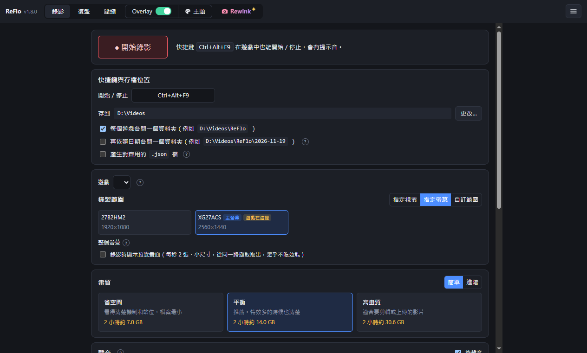
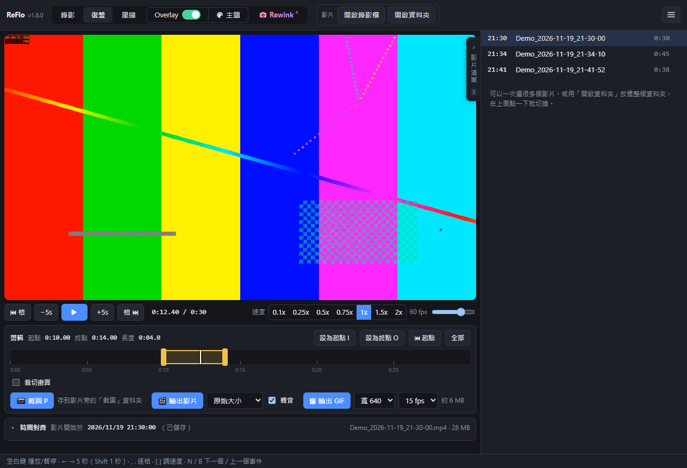
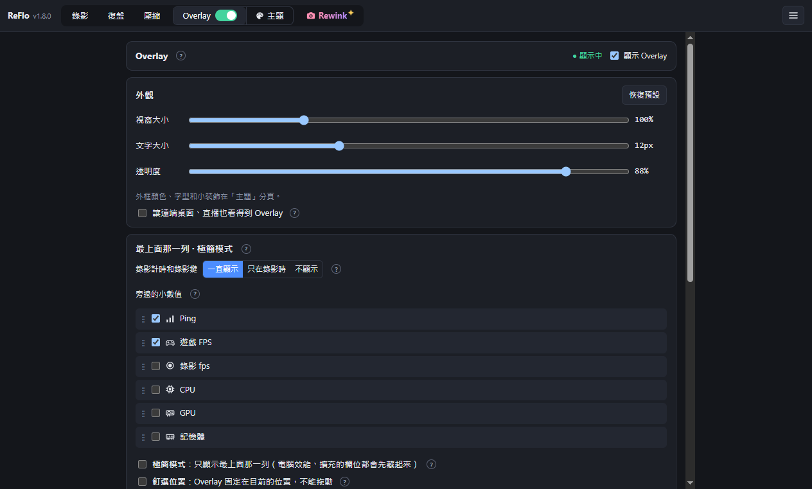
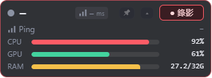
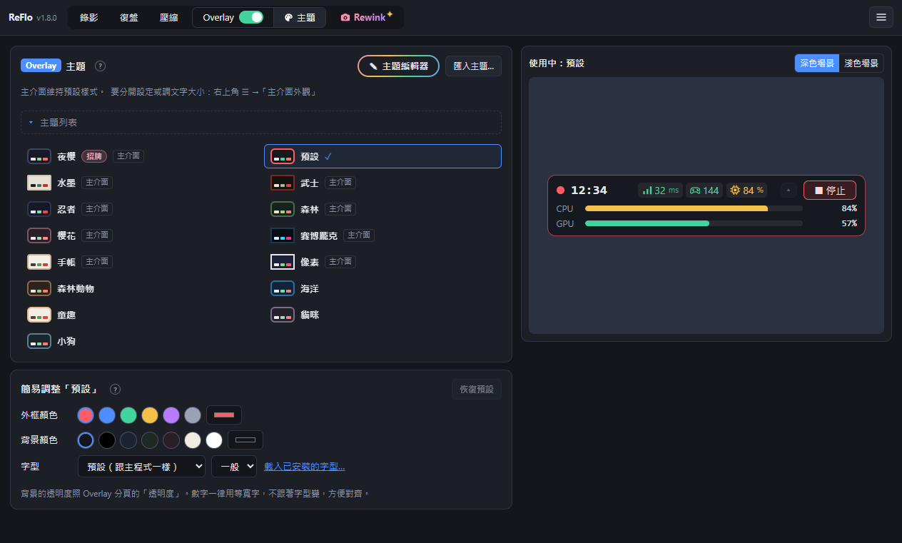
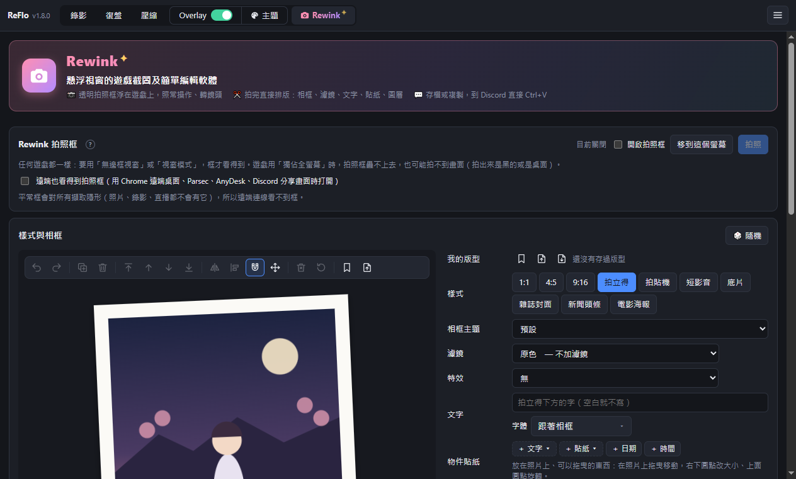
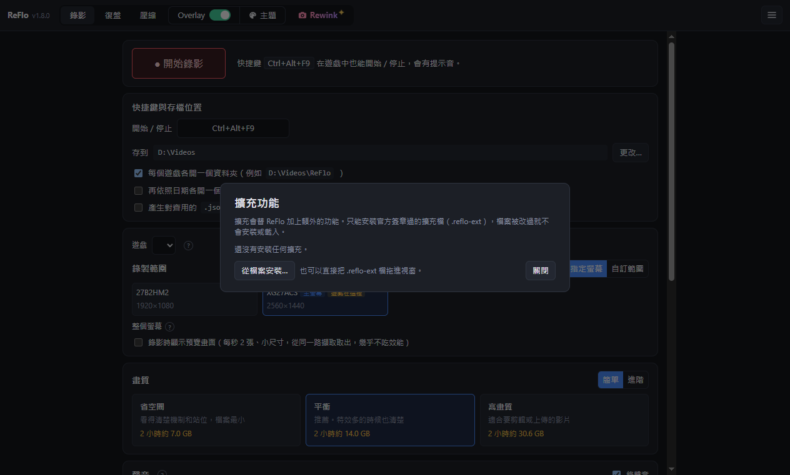

# ReFlo 操作手冊

適用版本：ReFlo 1.9.0

ReFlo 是遊戲的錄影、播放、拍照工具，任何遊戲都能用。上方的分頁就是它的功能：**錄影**、**復盤**（播放與擷取片段）、**壓縮**、**Overlay**、**主題**，還有 **Rewink 拍照框**。
第一次開啟時可以從右上角 ☰ →「功能導覽」看一遍，每個設定旁邊的「?」滑鼠指過去也有說明。

## 快速開始

1. 到「錄影」頁選**存檔位置**和**錄什麼**（某個遊戲的視窗、整個螢幕，或框選一塊範圍）。
2. 選一個**畫質**，其他照預設就可以。
3. 按**開始錄影**，或在遊戲裡按快捷鍵（預設 Ctrl+Alt+F9）開始 / 停止，會有提示音。
4. 錄好的影片在「復盤」頁打開，就能播放，也能擷取片段。

## 錄影

- **錄什麼**：
  - **視窗**：只錄這個程式的視窗，其他視窗蓋在上面也不會被錄到。換一個遊戲的視窗，就換成那個遊戲自己的錄影設定。
  - **螢幕**：錄整個螢幕。
  - **框選範圍**：在螢幕上拉一個框，只錄框裡面。
- **畫質**：會依你的顯卡自動選編碼方式（NVIDIA / AMD / Intel 硬體編碼，沒有顯卡時用 CPU）。不確定時可以按「效能測試」，它會建議適合這台電腦的設定。
- **聲音**：可以只錄遊戲本身的聲音（其他程式的聲音不會混進來），Discord 語音和自己的麥克風各自是一條音軌，用其他剪輯軟體時可以分開調整。
- **檔名和資料夾**：影片依遊戲分資料夾，檔名帶錄影時間。

## 復盤（播放與擷取片段）

- **開啟錄影檔**：可以一次選很多個（播放清單），或用「開啟資料夾」把整個資料夾放進來，也能直接把影片拖進視窗。
- **影片清單**：開了的影片列在右邊，點一下就切換。清單左上角有一個直式的「影片清單」書籤，點它就把清單收起來，影片畫面變大；收起後書籤貼在視窗右邊，再點一下就展開。只開一個影片時清單一開始是收起來的；你收起或展開過一次之後，就照你的選擇。
- **擷取片段**：設定起點和終點，把這一段輸出成影片、GIF 或截圖；也可以裁切畫面。目前一次輸出一段，還不能把好幾段接起來。

## 壓縮

把整批錄影檔壓小，大多能省一半以上空間。原檔會先保留，確認沒問題再刪。

## Overlay（懸浮小窗）

- 浮在遊戲上面的小視窗，可以直接按錄影 / 停止；**不會被錄進影片**。
- 顯示 Ping、遊戲 FPS、CPU / GPU / 記憶體，每一項都能單獨開關、拖動調整順序；不錄影也能當成監控儀表板。
- 遊戲 FPS 需要開著 RivaTuner Statistics Server（RTSS，MSI Afterburner 附帶），Overlay 分頁裡有設定教學。
- **極簡模式**只留最上面一列，最不擋畫面；**釘選**之後就不會被不小心拖走。

## 主題

- 15 個 Overlay 主題（招牌「夜櫻」），部分主題連主視窗也一起換。
- 主題編輯器可以調顏色、外框、字型、裝飾，上傳自己的圖片；做好的主題可以匯出分享給朋友，朋友把檔案拖進視窗就能匯入。

## Rewink 拍照框

- 在遊戲畫面上放一個透明的拍照框，拖曳、縮放、轉角度，按快門倒數拍照；拍照框和 Overlay 不會入鏡。
- 樣式：1:1、4:5、9:16、拍立得、拍貼機（倒數連拍）、Reels、底片、雜誌封面、新聞頭條。
- 相框、濾鏡、特效、貼紙和文字；照片上的每個東西都能移動、縮放、旋轉、隱藏、調整上下順序；可以用電腦裡的字型、上傳自己的貼紙。
- 排好的版面可以存成「我的版型」，或匯出分享。
- 拍好的照片存檔同時複製到剪貼簿，Discord 直接貼上；也能拍動圖。

## 擴充功能

擴充會替 ReFlo 加上某個遊戲專用的功能（例如自動錄影、戰鬥紀錄復盤、Overlay 的戰鬥資訊）。擴充是另外下載的 `.reflo-ext` 檔，在右上角 ☰ →「擴充功能」管理：

- **安裝**：按「從檔案安裝」選擇擴充檔，或直接把 `.reflo-ext` 檔拖進 ReFlo 的視窗。安裝前會顯示名稱、版本和說明，確認後才安裝。
- **只會安裝官方簽章過的擴充**：檔案被改過、或不是官方發布的，都不會安裝或載入，畫面上會寫明原因。
- **停用、移除**：每個擴充都可以停用或移除；移除後它的設定會留著，重新安裝就會恢復。
- **重新開啟後生效**：安裝、更新、停用、移除之後，按「立即重新開啟」或下次開啟 ReFlo 時才會生效。
- **更新**：ReFlo 開啟時會檢查擴充的新版，有新版時 ☰ 上會有小圓點，到「擴充功能」按「更新」就好；也可以手動按「檢查更新」。新版需要較新的 ReFlo 時，會提示先更新 ReFlo。

## 更新

安裝版開啟時會自動檢查新版本，有新版會在右上角提示，按一下就會下載並重新開啟，設定都會保留。免安裝版只會提示並打開下載頁。擴充的更新見上面「擴充功能」。
