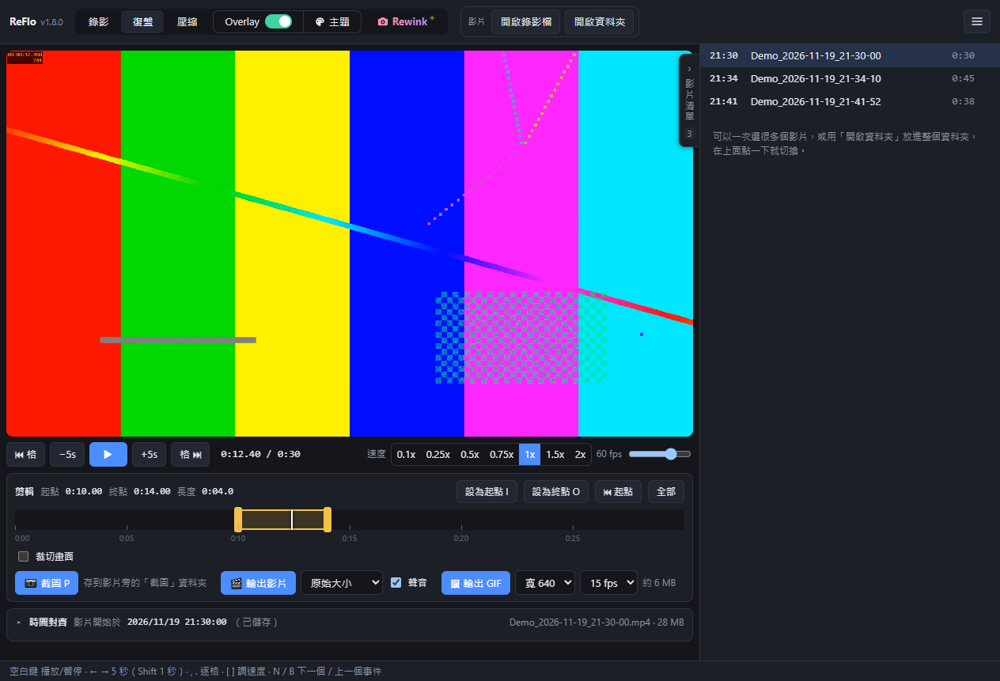
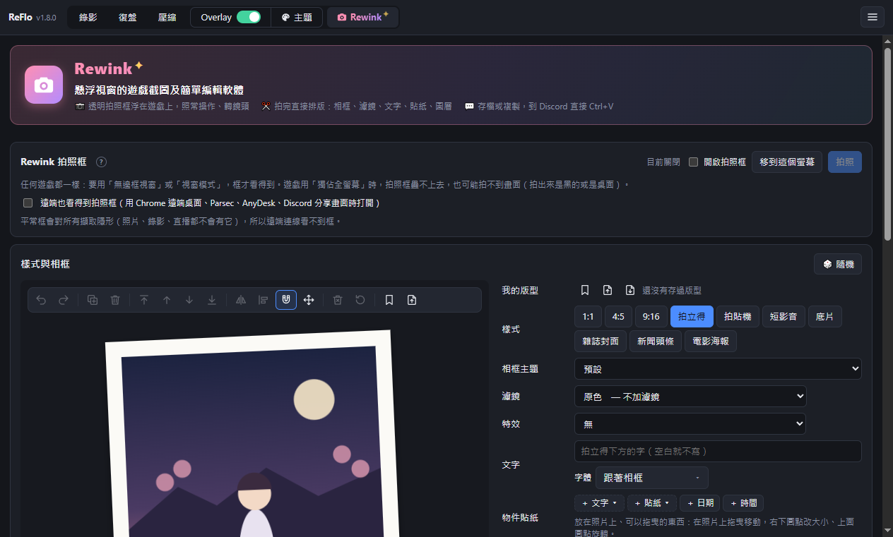

# ReFlo

遊戲**錄影、播放、拍照**工具，任何遊戲都能用。作者：LaneBlossom

> **ReFlo** = **Re**（再一次）＋ **Flo**（flow 流動、flora 花開）——讓遊戲裡的精彩時刻，跟朋友再開一次花。
> *Rewind the fight. Relive it with your squad.*

  
  

- **錄影**：顯卡硬體編碼；可以只錄遊戲視窗、整個螢幕，或框選一塊範圍；遊戲聲音、Discord 語音、自己的麥克風可以分成不同音軌
- **播放與擷取片段**：一次開很多個影片（影片清單）；選一段輸出成影片、GIF 或截圖，也能裁切畫面
- **Rewink 拍照框** ✦：遊戲畫面上的透明拍照框，拖曳、縮放、轉角度，按快門倒數拍照（框和 Overlay 不會入鏡）
  - 拍立得、拍貼機、短影音、底片、雜誌封面、新聞頭條、電影海報等樣式，加相框、濾鏡、特效、文字和貼紙，也能拍動圖
  - 照片上的每個東西都能移動、縮放、旋轉；可以用電腦裡的字型、上傳自己的貼紙，排好的版面存成「我的版型」分享給朋友
  - 存檔同時複製，到 Discord 直接貼上
- **Overlay**：浮在遊戲上直接錄影 / 停止；顯示 Ping、遊戲 FPS、電腦效能；不錄影也能當監控儀表板，不會被錄進影片
- **主題**：15 個 Overlay 主題（招牌「夜櫻」），也能用主題編輯器做自己的主題、上傳圖片、分享給朋友；部分主題連主視窗也一起換
- **壓縮**：一次壓縮整批錄影檔，大多能省一半以上空間
- **擴充**：可以另外安裝官方擴充，替特定遊戲加上專用功能（☰ →「擴充功能」，只接受官方簽章過的擴充檔）

## 📥 [安裝說明](INSTALL.md)　　📖 [操作手冊](MANUAL.md)

- **[安裝說明](INSTALL.md)**：下載、安裝、Windows 警告、防毒例外、更新、解除安裝
- **[操作手冊](MANUAL.md)**：快速開始，以及每個頁面、每個功能怎麼用（附圖解）

## 下載

👉 **[到 Releases 下載最新版](../../releases/latest)**

| 檔案 | 說明 |
|---|---|
| `ReFlo-Setup-x.x.x.exe` | **安裝版（推薦）**，之後在軟體裡按一下就能更新 |
| `ReFlo-Portable-x.x.x.exe` | 免安裝版，點兩下就能用，但不能自動更新 |

第一次開啟時 Windows 可能顯示「Windows 已保護您的電腦」：按 **其他資訊 → 仍要執行**。詳細步驟見[安裝說明](INSTALL.md)。

## 需求

- Windows 10 / 11（64 位元）
- 建議有 NVIDIA / AMD / Intel 顯卡（沒有也能錄，但會吃 CPU）
- 顯示遊戲 FPS 需要 RivaTuner Statistics Server（RTSS，MSI Afterburner 附帶）

## 授權與著作權

© 2026 [LaneBlossom](https://github.com/LaneBlossom)，保留所有權利。

ReFlo 可以免費下載、個人使用，也歡迎分享下載頁面的連結。但**未經作者同意，請勿反編譯或解開程式（例如解開 app.asar）、交給 AI 或其他工具分析改寫、修改、重新散布或以它為基礎製作類似的軟體**。完整條款見 [LICENSE](LICENSE)。

內附的 FFmpeg、Electron 等第三方元件依各自的授權條款提供。

## 非官方工具聲明

ReFlo 是玩家自製的**非官方工具**，與任何遊戲的開發商、發行商或營運商無關，未獲其授權、贊助或認可。遊戲名稱、商標、圖像及遊戲畫面的權利屬於其各自的權利人。

- ReFlo 不修改遊戲程式或檔案，不讀寫遊戲的記憶體，也不攔截遊戲的網路封包；它錄下的是你自己螢幕上的畫面與聲音。
- RTSS 是其作者的軟體，ReFlo 沒有內附它，也與它無關。
- 擴充是另外下載的檔案，各擴充的說明和聲明見它自己的下載頁。
- 錄下、擷取與分享遊戲畫面時，請遵守各遊戲及平台的使用條款與素材使用規範。完整條款見 [LICENSE](LICENSE)。
